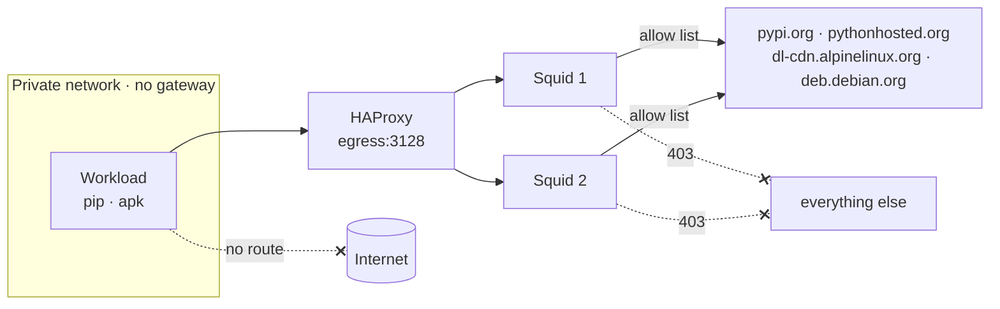

# Controlled egress with Squid proxies

Workloads in a **private network with no route to the internet** can still install packages, but only from an **allow list**, and only **through Squid**.
Two proxies behind HAProxy keep egress up if one fails, and every request, allowed or not, is on record.
Every push proves all of it.

[Live pipeline →](https://danielkojomegbenu.com/projects/squid-egress-proxy)

## The architecture



| Piece | What it does |
|---|---|
| **Private network** | A Docker `internal` network: no gateway and no route out, just like a private subnet without a NAT gateway |
| **Squid × 2** | Forward proxies on both networks. They allow only the domains in `squid/allowlist.txt`, check HTTPS by the CONNECT hostname **without decrypting it**, don't cache, and strip client details |
| **HAProxy** | The workloads' one proxy address, `egress:3128`. It health-checks both Squids and sends traffic only to healthy ones |
| **Allow list** | `.pypi.org`, `.pythonhosted.org`, `dl-cdn.alpinelinux.org`, `deb.debian.org`. Adding a repository is a one-line, reviewed change |

## What every run proves

| Check | How | Fails when |
|---|---|---|
| No direct internet | The workload tries pypi.org with the proxy settings removed. It has nowhere to go | The workload reaches the internet without the proxy |
| Allowed | `pip install requests`, `apk add jq`, and a request to deb.debian.org, all through the proxy | A package install fails |
| Blocked | example.com, github.com, api.openai.com and a plain-HTTP site are all **turned back with 403** | Anything outside the allow list gets through |
| High availability | One Squid is stopped, and `pip download` still works through the other | Egress depends on a single proxy |
| Audit | Both Squids' logs are tallied: cleared vs turned back, by destination | A request isn't on record |

## On AWS

The same design in a VPC:
- The workloads sit in private subnets with **no NAT gateway**.
- Two Squid instances in public subnets, in different Availability Zones, sit behind an internal Network Load Balancer.
- `squid.conf` and the allow list are unchanged.
- Security groups allow the private subnets to reach port 3128 only.

## See an open proxy fail the run

Open the pull request **demo/allow-everything**. It adds `http_access allow all` to "unblock a team quickly".
Package installs still work, but the **Blocked** check fails: everything outside the allow list now gets through.

## Run it on your machine

```bash
docker compose up -d --build
for c in direct allowed blocked ha audit; do bash scripts/checks.sh $c; done
docker compose down
```

## What's in the repo

| Path | What it is |
|---|---|
| `squid/` | The Squid image, `squid.conf` and `allowlist.txt` |
| `haproxy/haproxy.cfg` | The single proxy address in front of both Squids |
| `docker-compose.yml` | The private network, the proxies and a workload |
| `scripts/checks.sh` | The five proofs |
| `.github/workflows/egress.yml` | The pipeline |

## Cost

Free. Everything runs on the GitHub runner, and GitHub Actions is free for public repos.
